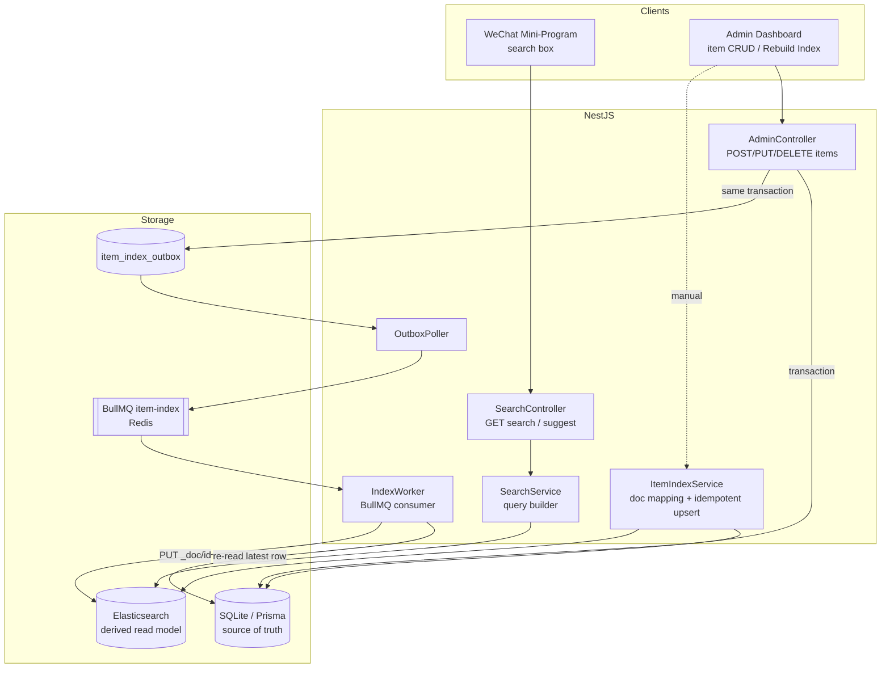
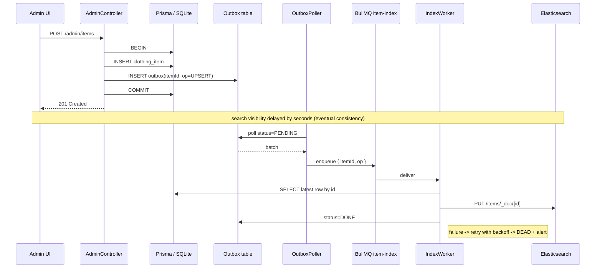
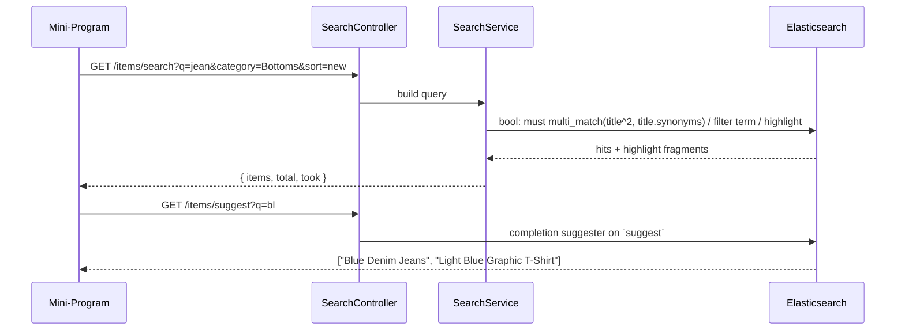

# Item Search (v0.3.0) — Technical Design

## 1. Goals

- Full-text search over item titles with an English analyzer
- Type-ahead suggestions, category / new-arrival filters, keyword highlighting
- Reliable DB → Elasticsearch synchronization with a rebuild fallback
- A demo corpus large enough to make search behavior visible

Non-goals: personalized ranking, faceted aggregation, multi-language (Chinese) analysis.

## 2. Architecture



Key principle: **the database is the single source of truth; Elasticsearch is a derived, disposable read model.** A write never fails because ES is down.

## 3. Write path (eventual consistency)



Why Outbox: writing the business row and the change event in **one transaction** makes "DB committed but event lost" impossible. Why re-read from DB in the worker: the queue carries only `itemId`, so out-of-order or duplicated jobs always write the latest state.

Deletes are handled as `op=DELETE` events (`DELETE /items/_doc/{id}`), never by scanning ES.

## 4. Read path



Client-side: 300 ms debounce, empty state, recent keywords in local storage.

## 5. Index design

Index name: `items_v1`, exposed through alias `items` (so a full rebuild can write `items_v2` and switch the alias atomically, zero downtime).

| Field | Type | Purpose |
|-------|------|---------|
| `id` | keyword (`_id` = DB primary key) | idempotent upsert |
| `title` | text, analyzer `apparel` | full-text search |
| `title.raw` | keyword | sorting / exact match |
| `category` | keyword | filter (`Tops` / `Bottoms`) |
| `isNew` | boolean | filter |
| `sort` | integer | default ordering |
| `image` | keyword (not indexed) | display only |
| `suggest` | completion | type-ahead |

Analyzer `apparel`: `standard` tokenizer → `lowercase` → `english_possessive_stemmer` → `apparel_synonyms` → `english_stemmer`.

Synonyms (apparel domain): `pants, trousers, chinos, bottoms`; `tee, t-shirt, tshirt, tops`; `coat, jacket, outerwear`.

Note: DB category values remain Chinese (`上衣` / `裤子`) for backward compatibility; they are mapped to `Tops` / `Bottoms` in `ItemIndexService`.

## 6. Demo corpus

`server/prisma/items.json` — ~50 items generated once, committed to the repo (no runtime AI calls, reproducible).

Deliberately includes analyzer test cases: singular/plural (`Jean` / `Jeans`, `Dress` / `Dresses`), hyphen variants (`T-Shirt` / `T Shirt`), synonyms (`Trousers`, `Pants`, `Chinos`), multi-word color/material combos (`Blue Denim`, `Dark Leather`), and a few long titles for highlighting.

Images reuse the 6 existing compressed files cyclically (`/static/clothes/{i % 6 + 1}.jpg`) — image variety does not affect search quality.

`seed.ts` reads `items.json` and uses `upsert` so existing try-on records are preserved (the current seed deletes them).

## 7. File layout

```
server/
├── prisma/
│   ├── items.json                     # demo corpus
│   ├── seed.ts                        # upsert-based seeding
│   └── schema.prisma                  # + ItemIndexOutbox model
├── src/
│   ├── search/
│   │   ├── search.module.ts
│   │   ├── search.controller.ts       # GET /items/search, /items/suggest
│   │   ├── search.service.ts          # query building
│   │   ├── elasticsearch.provider.ts  # client + index bootstrap
│   │   ├── item-index.service.ts      # doc mapping, upsert/delete, rebuild
│   │   ├── outbox.poller.ts           # pending -> queue
│   │   └── index.worker.ts            # BullMQ consumer
│   ├── admin/
│   │   └── admin.controller.ts        # emit outbox events on CRUD + rebuild endpoint
│   └── app.module.ts                  # import SearchModule
client/src/pages/search/               # search box + results
admin/src/pages/SearchSettings.tsx     # "Rebuild index" button (optional)
docs/design/item-search.md             # this document
```

## 8. API contract

| Method | Path | Response |
|--------|------|----------|
| GET | `/items/search?q=&category=&isNew=&sort=` | `{ items, total, took }` with `highlight` fragments |
| GET | `/items/suggest?q=` | `string[]` |
| POST | `/admin/items/reindex` | `{ indexed, took }` (full rebuild) |

## 9. Consistency & failure handling

| Risk | Mitigation |
|------|-----------|
| ES write fails / ES down | Outbox row stays PENDING, worker retries with backoff; admin write already succeeded |
| Repeated / out-of-order jobs | `PUT _doc/{id}` is idempotent; worker re-reads latest DB row |
| Poison job | after N attempts → `status=DEAD` + log/alert |
| Silent drift | scheduled reconciliation (DB ids vs ES ids) + manual Rebuild Index |
| Mapping change | build `items_v2`, reindex, atomically switch alias `items` |
| ES unavailable at boot | log warning, keep API up, serve empty results with a clear status |

## 10. Implementation phases

1. Corpus: `items.json` + `upsert` seed
2. ES bootstrap: provider, mapping, alias, health check
3. Sync: Outbox model, poller, `item-index` queue, worker
4. Query: search + suggest endpoints, filters, highlighting
5. Client: search page with debounce and suggestions
6. Admin: Rebuild Index action
7. Docs: README (`IK analyzer` → `English analyzer`), env vars, roadmap `[x]`

## 11. Environment

| Variable | Example |
|----------|---------|
| `ELASTICSEARCH_URL` | `http://localhost:9200` |
| `ELASTICSEARCH_INDEX` | `items_v1` |
| `REDIS_URL` | reused from v0.2.0 |

Local ES 8 requires `xpack.security.enabled: false` in `elasticsearch.yml` for password-free development.

## 12. Trade-offs

- **Outbox vs CDC**: CDC (binlog/Debezium) removes all instrumentation from app code but needs extra infrastructure. Outbox is intentionally chosen here: it reuses the existing Prisma + BullMQ stack and demonstrates the consistency pattern explicitly.
- **SQLite**: fine for local development; production would move to PostgreSQL (also unlocks native CDC).
- **Scale**: ~50 items is far below ES's useful threshold; the value of this work is the architecture (sync, idempotency, consistency, rebuild), not the data volume.
